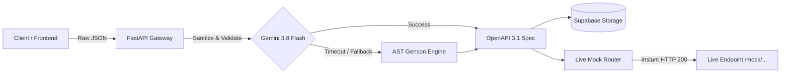

# ⚡ API-Pulse

> **Turn raw JSON into production-ready OpenAPI 3.1 specifications and live mock APIs in seconds.**

API-Pulse is an enterprise-grade Developer Tool designed to bridge the gap between frontend and backend teams. By providing raw JSON payloads, developers instantly receive strict OpenAPI 3.1 specifications and live, callable mock endpoints with resilient AI fallbacks.

---

## 🚀 Key Features

- **Instant Live Mocks:** Generates live, queryable mock endpoints (`/mock/{schema_id}/{path}`) that return valid JSON responses with full CORS support.
- **AI-Powered OpenAPI 3.1:** Infers rich schema types, properties, formats, and status codes using **Google Gemini 3.8 Flash**.
- **Deterministic AST Fallback:** If the AI model times out or encounters network limits, an in-process AST schema generator (`genson`) takes over with 0ms downtime.
- **GitHub OAuth & Supabase Auth:** Seamless 1-click authentication for developers.
- **Automated Sanitization:** Redacts sensitive credentials (AWS keys, Bearer tokens, passwords) before processing.
- **Monaco Editor Integration:** In-browser syntax-highlighted IDE for inspecting and copying OpenAPI schemas.

---

## 🏗️ Architecture



---

## 🛠️ Tech Stack

- **Frontend:** [Next.js 16](https://nextjs.org/) (App Router, Turbopack, Tailwind CSS, Lucide Icons, Monaco Editor)
- **Backend:** [FastAPI](https://fastapi.tiangolo.com/) (Python 3.11+, Pydantic, SlowAPI Rate Limiting)
- **AI Engine:** [Google Generative AI](https://aistudio.google.com/) (`gemini-3.8-flash`)
- **Database & Auth:** [Supabase](https://supabase.com/) (PostgreSQL, Row Level Security, GitHub OAuth)
- **Edge Deployment:** [Cloudflare Workers](https://workers.cloudflare.com/) / FastAPI Live Mock Router

---

## 🏁 Getting Started

### 1. Prerequisites
- Node.js 18+ & npm
- Python 3.10+
- A free [Google AI Studio API Key](https://aistudio.google.com/)
- A free [Supabase](https://supabase.com/) project

---

### 2. Backend Setup

```bash
# Navigate to backend
cd backend

# Create & activate virtual environment
python -m venv .venv
source .venv/bin/activate # On Windows: .venv\Scripts\activate

# Install dependencies
pip install -r requirements.txt

# Configure environment variables (.env)
cp .env.example .env # or edit backend/.env
```

**`backend/.env` configuration:**
```env
SUPABASE_URL=https://your-project.supabase.co
SUPABASE_KEY=your-supabase-service-role-key
GEMINI_API_KEY=your-google-ai-studio-api-key
GEMINI_MODEL=gemini-3.8-flash
LEMON_SQUEEZY_WEBHOOK_SECRET=your-webhook-secret
ALLOWED_ORIGINS=http://localhost:3000,https://your-app.vercel.app
```

**Start the FastAPI server:**
```bash
uvicorn main:app --reload --port 8000
```
API docs available at: `http://localhost:8000/docs`

---

### 3. Frontend Setup

```bash
# Navigate to frontend
cd frontend

# Install dependencies
npm install

# Configure environment variables (.env.local)
cp .env.example .env.local
```

**`frontend/.env.local` configuration:**
```env
NEXT_PUBLIC_SUPABASE_URL=https://your-project.supabase.co
NEXT_PUBLIC_SUPABASE_ANON_KEY=your-supabase-anon-key
NEXT_PUBLIC_API_URL=http://localhost:8000
```

**Start the Next.js development server:**
```bash
npm run dev
```
Open [http://localhost:3000](http://localhost:3000) in your browser.

---

## 🧪 Testing the Live Mock

Once your backend is running, test a mock endpoint with `curl`:

```bash
# 1. Generate a mock
curl -X POST "http://localhost:8000/api/generate?method=GET&path=/api/users" \
     -H "Content-Type: application/json" \
     -d '{"id": 1, "name": "Bruce Wayne", "role": "CEO"}'

# Response contains:
# { "schema_id": "...", "mock_url": "http://localhost:8000/mock/<id>/api/users", ... }

# 2. Query the live mock endpoint
curl "http://localhost:8000/mock/<id>/api/users"
# Returns: {"id": 1, "name": "Bruce Wayne", "role": "CEO"} with status 200 OK
```

---

## 📄 License
MIT License. Built for modern engineering teams.
